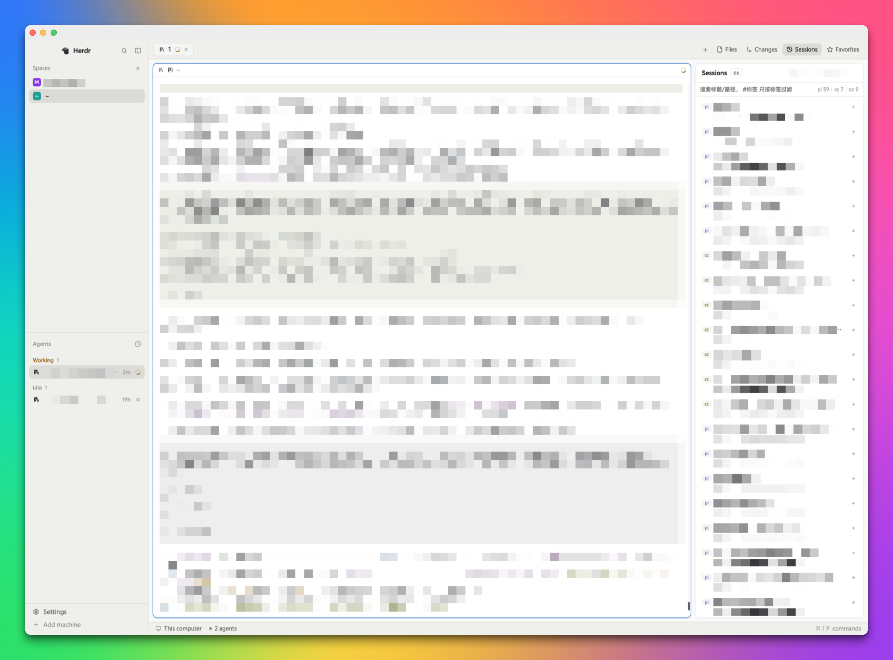

# Herdr Sessions

A [Herdr](https://herdr.dev) layout for people who drive coding agents all day: your spaces and
tabs on the left, the terminal in the middle, and a right-hand panel with **Files**, **Changes**,
**Sessions** and **Favorites**.



一个给 [Herdr](https://herdr.dev) 用的布局：左边是空间和标签，中间是终端，右侧一个面板，装
**文件 / 改动 / 会话 / 收藏** 四件事。

---

## 中文

### 这是什么

| 区域 | 里面是什么 |
| --- | --- |
| 左侧栏 268px | 空间列表（可改颜色、重命名、新建）、Agent 列表、底部状态 |
| 顶部 42px | 打开的标签、四个面板开关、窗口按钮 |
| 中间 | 终端。标题栏和窗口按钮的位置都留好了，窄的时候也不会挤掉 |
| 右侧面板 368px | 四个面板叠在一起，点顶栏按钮切换；**默认收起** |
| 底部 28px | 状态栏 |

右侧四个面板：

- **Files** — 当前项目的文件树，点文件直接预览。鼠标悬停在文件夹行上会出现三个小按钮：
  ⭐ 收藏这个目录、`>_` 把路径 cd 进当前终端、复制按钮把绝对路径写进剪贴板。
- **Changes** — 当前项目的 git 改动，逐个文件看 diff，填提交信息，点 **Commit** 提交。
  输入框旁有个 **AI** 按钮：用 `pi -p` 读最近的提交风格和这次 diff，生成一句中文提交信息填进输入框（只支持本地仓库）。
- **Sessions** — 会话记录。**只列当前 space 所在项目的会话**，pi / Claude Code / opencode 三种都收，
  点一条就在它原来的目录里恢复那个会话。每条两行再加一行标签：标题、时间和路径、标签。
  搜索框里写 `#标签` 就只按标签过滤，`#数据 #对账` 要求两个标签都有，`#数据 跑` 是标签加关键词。
  行右侧的 `+` 加标签（逗号分隔），保存后显示成标签块，点标签块上的 ✕ 删掉。
- **Favorites** — 收藏的目录，一条一行，点一下切到那个目录（已经开着就直接切过去，没开就新建一个 space）。
  顶部「收藏当前目录」存的是当前 space 的项目目录，「浏览文件夹收藏…」可以挑任意文件夹。

### 安装

```bash
git clone https://github.com/<你的用户名>/herdr-sessions.git /tmp/herdr-sessions
bash /tmp/herdr-sessions/install.sh
```

脚本会备份同名文件、把 `layouts/sessions.json` 和 6 个 mod 拷进 `~/.config/herdr-app`、
逐个 `herdr-app check`，最后切到 `sessions` 布局。装完点顶栏右侧按钮打开面板。

手动安装也可以：把 `layouts/sessions.json` 拷到 `~/.config/herdr-app/layouts/`，
把 `mods/hs-*` 六个目录拷到 `~/.config/herdr-app/mods/`，然后
`herdr-app do layout.switch --name sessions`。

### 依赖

`install.sh` 会检查并告诉你缺哪个，缺了只影响对应的功能：

| 程序 | 用来做什么 | 没有会怎样 |
| --- | --- | --- |
| `python3` | 扫会话文件 | Sessions 列表空着 |
| `git` | Files / Changes / Spaces 的状态和 diff | 改动面板和分支显示没内容 |
| `sqlite3` | 读 opencode 的会话库 | 不列 opencode 会话 |
| `pi` | 会话标题、点一条恢复会话 | 标题退回首条消息，不能恢复 |
| `claude` | 恢复 Claude Code 会话 | 不列/不能恢复 cc 会话 |

### 关于语言

界面文案是**中文写死的，布局本身无法中英切换**。要英文界面，只能自己改字符串，
主要在这几个文件里（都在 `mods/*/main.js`）：

- `mods/hs-tabs/main.js` — 顶栏四个按钮的 `Files` / `Changes` / `Sessions` / `Favorites`
- `mods/hs-sessions/main.js` — `Sessions`、`搜索标题/路径， #标签 只按标签过滤`、`标签，逗号分隔`、`保存`
- `mods/hs-favorites/main.js` — `Favorites`、`收藏当前目录`、`浏览文件夹收藏…`、`还没有收藏`
- `mods/hs-files/main.js` — `Files`、`已收藏`、`路径已复制`
- `mods/hs-changes/main.js` — `Changes`、`Commit message`

改完存盘，切走再切回这个布局就会加载新文案（`herdr-app do layout.switch --name main` 再切回来）。

### 卸载

```bash
bash uninstall.sh
```

只删 `layouts/sessions.json` 和你装进来的 6 个 mod，安装时若有备份会还原。
你收藏的目录和标签留在 `shared.json` 的 `hs.favorites`、`hs.sessions.tags` 里，想清就自己删。

---

## English

### What it is

A layout for [Herdr](https://herdr.dev). Left sidebar: spaces (rename, colour, new) and agents.
Top bar: your tabs plus four panel buttons and the window buttons. Middle: the terminal.
Right: one 368px panel holding **Files**, **Changes**, **Sessions** and **Favorites**, stacked and
**collapsed by default** — click a button in the top bar to open it.

- **Files** — file tree of the current project, click a file to preview it. Hovering a folder row
  reveals three buttons: ⭐ save it to Favorites, `>_` `cd` into it in the focused terminal,
  and copy its absolute path to the clipboard.
- **Changes** — git changes of the project with per-file diffs, a commit message box and
  **Commit**. The **AI** button next to the box asks `pi -p` for a one-line commit message in the
  style of your last commits and puts it in the box (local repositories only).
- **Sessions** — session history. It lists **only the sessions of the current space's project**,
  from pi, Claude Code and opencode, and clicking one resumes it in the folder it was recorded in.
  Each row is title / time and path / tags. In the search box, `#tag` filters by tag only,
  `#data #recon` requires both, `#data run` is a tag plus keywords. `+` on a row adds tags
  (comma separated); click ✕ on a tag to drop it.
- **Favorites** — saved folders, one per line. Click to switch to that folder: it selects the
  space already open there, or makes a new one. `收藏当前目录` saves the current space's project
  folder, `浏览文件夹收藏…` lets you pick any folder.

### Install

```bash
git clone https://github.com/<you>/herdr-sessions.git /tmp/herdr-sessions
bash /tmp/herdr-sessions/install.sh
```

The script backs up anything it would replace, copies `layouts/sessions.json` and the six mods into
`~/.config/herdr-app`, runs `herdr-app check` on each, and switches to the layout.

Or by hand: copy `layouts/sessions.json` to `~/.config/herdr-app/layouts/`, copy the six
`mods/hs-*` folders to `~/.config/herdr-app/mods/`, then
`herdr-app do layout.switch --name sessions`.

### Requirements

`install.sh` reports what is missing; a missing program only disables its own feature.
`python3` scans sessions (without it the list stays empty), `git` gives the Changes panel something
to show, `sqlite3` reads opencode's database, `pi` provides session titles and resume, and `claude`
is needed to resume Claude Code sessions.

### Language

**The interface copy is written in Chinese and the layout cannot switch languages.** For an English
UI you have to edit the strings yourself, mainly in `mods/*/main.js`: the four button labels in
`mods/hs-tabs/main.js`, the header, search placeholder and tag prompt in `mods/hs-sessions/main.js`,
and the labels in `mods/hs-favorites/main.js`, `mods/hs-files/main.js` and `mods/hs-changes/main.js`.
Save, then switch away from the layout and back (`layout.switch --name main`, then back) to reload.

### Uninstall

```bash
bash uninstall.sh
```

It removes `layouts/sessions.json` and the six mods, restoring install-time backups if there were any.
Saved folders and tags stay in `shared.json` under `hs.favorites` and `hs.sessions.tags`.

---

## 发布到 herdr.dev / Publishing

推到 GitHub 后给仓库加 topic **`herdr-layout`**，一小时内会出现在
[herdr.dev/layouts](https://herdr.dev/layouts)。Add the topic `herdr-layout` to the repository and
it shows up there within the hour. `RECIPE.md` is the brief another agent builds this from.

## 友情链接
[LINUX DO](https://linux.do/) —— 真诚分享、友好讨论的技术社区，本项目的交流与反馈也发布于此