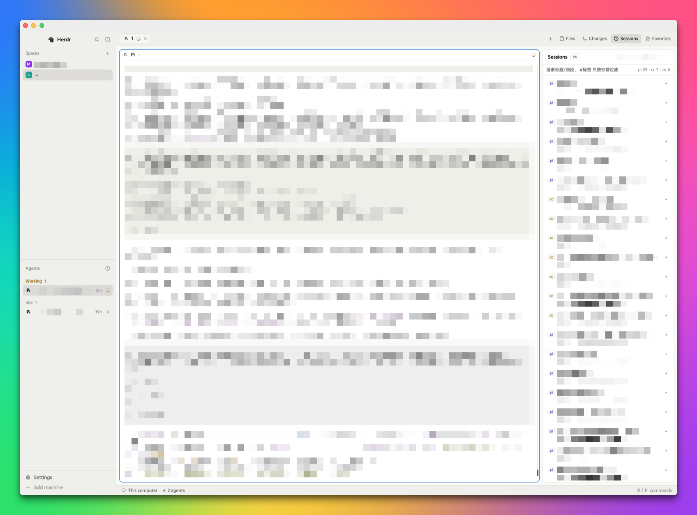

# Herdr Sessions

A working layout for people who drive coding agents: a 268px sidebar with spaces and agents, a
42px tab bar with four panel buttons, the terminal in the middle, and one 368px right panel that
stacks **Files**, **Changes**, **Sessions** and **Favorites** — collapsed by default, opened from
the tab bar. Everything follows the person's theme tokens, so it looks native in light and dark.

**What you see:** top to bottom, left to right — a 268px sidebar (46px chrome bar with the window
lights and drag area, then spaces and agents stacked at `weight 1` / `min 90` each, then a 69px
footer), a 42px tab bar, then a row with the terminal and a 368px right panel (`min 280`,
`max 900`, `hidden: true`), and a 28px status bar. Padding 8, gap 8 around the terminal, pane radius
10, 1px `border` with a 1px `accent` focus ring, `terminal_padding` `[14, 12]`, traffic lights at
`[12, 16]`, `titlebar: "none"`. Type is the theme's own; sizes below.

**How it behaves:** each of the four panel buttons toggles its block inside the `panel-body` stack
(`layout.show`/`layout.hide` + `layout.select`) and the panel itself is hidden or shown; clicking the
button of the panel already open collapses the whole panel. Space tabs show their agent's status —
`working` gets a spinning `mods/workspace-chrome/spinner.svg`, a blocked or done agent gets its
program icon or tint. Hovering a tab reveals its ✕. In Files, hovering a folder row swaps in a
34px action group (⭐ favorite, `>_` cd, copy path); hovering anything else clears it. In Sessions,
hovering a row tints it, `+` turns the third line into a tag input, and the search box filters live
as you type. Nothing moves unless the person acts, except the working spinner and the 30s session
rescan.

## Built from

`layouts/sessions.json` — a `row` of `sidebar` (268px, `background: chrome`, `resizable: false`,
`min 44`, `max 480`) and `work` (column). Sidebar children: block `brand` → mod `workspace-chrome`
(46px, `window_drag: true`); column `sidebar-lists` → blocks `spaces` → mod `hs-spaces` and `agents`
→ shipped mod `agents` (both `weight 1`, `min 90`); block `sidebar-footer` → `workspace-chrome` with
`props: { footer: true }` (69px). Work children: block `tabs` → mod `hs-tabs` (42px,
`window_drag: true`); row `work-body` (padding 8, gap 8) → block `main` (`tab: "active"`, a `pane`
whose header is `pane` at `height 30`, `reveal: "always"`, `position: "top"`, `lone: true`) and
column `panel` (368px) → stack `panel-body` (`active: "files"`) with blocks `files` → `hs-files`,
`changes` → `hs-changes`, `sessions` → `hs-sessions`, `favorites` → `hs-favorites`; then block
`status` → `workspace-status` (28px). Root: `background: "canvas"`, `divider` 1px `border`,
`titlebar: "none"`.

Six mods, all `"place": "none"` (a block, never an overlay), `// @ts-nocheck` on line 1 since they
are plain JS:

- **hs-tabs** (`mods/hs-tabs/main.js`) — the tab bar. Space tabs from `spaces()`/`panes()`/`run`, a
  `ScrollHandle` for overflow, window buttons via `run("window.minimize"…)`. Four `panelButton`
  helpers call `run("layout.select", { stack: "panel-body", child: <id> })`, read whether that child
  is the stack's `active`, and `layout.hide`/`layout.show` the `panel` node. Panel buttons are gated
  on `enabled`, which is `shared("workspace.panels")` **plus** `"sessions"` and `"favorites"` always
  (a file edit to `shared.json` never reaches a running app's memory, only `setShared` does, and this
  mod has no way to call it — so it adds its own two instead of depending on the person's setting).
  Renaming a tab opens `new-menu` through `openOverlay`.
- **hs-spaces** (`mods/hs-spaces/main.js`) — the sidebar space list: colour per space in
  `shared("space.colors")`, rename/add/move via `run("space.rename"|"space.new"|"space.move"|
  "space.select")`, a branch label from `exec("git", …)`, and menus through `openOverlay`.
- **hs-files** (`mods/hs-files/main.js`) — file tree of the space's folder (`readTextFile`,
  `watchFolder`), previews through `EditorState`. Per-row actions: `setShared` into the favorites
  list, `cx.write_to_clipboard` for the path, and `hc send` into the focused terminal for `cd`.
  Art: `mods/hs-files/{cd,copy,folder,file,chevron-right,chevron-down}.svg`.
- **hs-changes** (`mods/hs-changes/main.js`) — `git status` + `git diff` per file, commit box,
  `Commit` runs `git commit`, and the **AI** button builds a prompt from `git log --oneline -5` plus
  6000 characters of diff and runs `exec("pi", ["-p", prompt], { cwd })` to fill the box.
- **hs-sessions** (`mods/hs-sessions/main.js`) — one `python3 -c` pass over `~/.pi/agent/sessions/*/*.jsonl`
  and `~/.claude/projects/*/*.jsonl` plus `sqlite3` on `~/.local/share/opencode/opencode.db`. For pi
  it takes `id` and `cwd` from the file's first line and the title from the **last**
  `{"type":"session_info","name":…}` entry, falling back to the first user message. Clicking a row
  runs `run("terminal.open", { argv, folder, place: "tab" })` with `pi --session <header id>`,
  `claude --resume <file uuid>` or `opencode`. Tags live in `shared("hs.sessions.tags")` keyed
  `pi:<file name>`, edited through an `InputState` per session, cached by key so re-renders never
  rebuild the input. `home()`, `theme()`, `notify()` throughout.
- **hs-favorites** (`mods/hs-favorites/main.js`) — flat list from `shared("hs.favorites")`, entries
  `{ name, folder, machine }`. A click runs `run("space.select")` when a `spaces()` entry matches on
  folder+machine, else `run("space.new", { folder, machine })`. `收藏当前目录` uses the active space's
  own `folder` (falling back to the focused pane's cwd only when the space has none — falling back
  always made switching spaces look like a no-op). `浏览文件夹收藏…` uses `pickFolder`. Art:
  `mods/hs-files/folder.svg`, `mods/hs-spaces/star.svg`, `mods/workspace-chrome/plus.svg`.

Shipped mods it relies on: `workspace-chrome`, `workspace-status`, `agents`, `pane`, `tabs`,
`files`, `changes`, `spaces`, `new-menu`. Note the cross-mod art: hs-tabs and hs-favorites read SVGs
out of `mods/hs-files/` and `mods/hs-spaces/`, so those two must be installed with them.

## Watch out

- `cloned_from` was stripped from the layout and every `mod.json`: left in, Herdr offers to update
  the mod from its upstream, which would overwrite these changes.
- The panel is `hidden: true` at first. People who do not find the four buttons think the layout is
  broken — the README says it twice.
- `cx.timer.every` is required for two things the layout would otherwise get wrong: a 30s session
  rescan, and a 500ms watcher over `spaces()`/`focused()` because **a panel is not re-rendered when
  the person switches space or focuses another terminal**.
- Editing a mod's file does not reload the copy already on screen. Switch to another panel and back
  (`layout.select --stack panel-body --child files`, then back), or another layout and back.
  Selecting the same child twice is a no-op.
- `shared.json` on disk is a snapshot of the app's memory; editing it changes nothing until a
  restart. Only `setShared` moves live state.
- `python3`, `sqlite3`, `git` and `pi` are called. Missing ones must degrade to an empty list or a
  toast, never to a broken panel.
- The copy inside the mods is Chinese. There is no i18n layer, so an English UI means editing
  strings (README lists which file holds which).
- Sizes are pixels at the person's font size; `max_w`/`truncate` everywhere a path can be long.

## Done when

- `herdr-app check` passes for all six mods and `herdr-app do layout.switch --name sessions` shows
  the layout with no entry in `herdr-app status`'s `errors`.
- Each of the four panel buttons opens its own panel and collapses on a second click.
- In Files, hovering a folder row shows ⭐/`>_`/copy, cd puts the path into the focused terminal,
  and the copy button leaves the absolute path on the clipboard.
- In Sessions, only the current space's project is listed; `#tag` narrows to tagged rows; `+` opens
  a tag input that saves without losing focus; clicking a row resumes that session in its folder.
- In Favorites, `收藏当前目录` saves the current space's project folder (not the focused terminal's),
  and clicking an entry switches to that space instead of making a duplicate.
- `uninstall.sh` removes `layouts/sessions.json` and the six mods and restores any install backup.